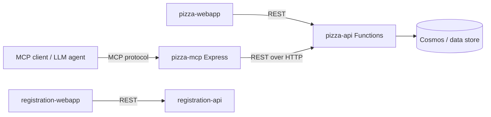

# Backend Service Architecture

User: Need your expertise. 

You helped me provision an MCP Server/Rest backend to Azure last week. Just getting back to it now. Can you scan the code and help me understand what endpoints the backend exposes, and whether they're REST, MCP, or some combination. Thanks

GitHub Copilot: I'll scan the backend code to map out the endpoints. Let me read the API functions and MCP server in parallel.   

Read 

Read 

Read 

Now let me look at the REST API functions and the registration API to complete the picture.    

Searched for regex `app\.(http|get|post|delete|put|timer)|route:` (`**/src/pizza-api/src/functions/**`), 20 results

Read 

Read , lines 1 to 60

Read , lines 1 to 60

Let me check the remaining functions — toppings categories, the timer, orders methods, and the registration API.    

Searched for regex `methods:|route:|app\.timer|schedule:|app\.http` (`**/src/pizza-api/src/functions/orders-post.ts`), 3 results

Read , lines 60 to 82

Read , lines 1 to 30

Read , lines 1 to 40

Here's the complete map of what your backend exposes. There are actually **three** deployable backends, and they split cleanly along the REST vs. MCP line.

## 1. `pizza-api` — REST (Azure Functions, HTTP triggers)

This is the system of record. Plain REST over Azure Functions, all `authLevel: 'anonymous'`, routes prefixed with `/api`:

| Method | Route | Function |
|--------|-------|----------|
| GET | `/api/pizzas` | pizzas-get.ts |
| GET | `/api/pizzas/{id}` | pizzas-get.ts |
| GET | `/api/toppings` (optional `?category=`) | toppings-get.ts |
| GET | `/api/toppings/{id}` | toppings-get.ts |
| GET | `/api/toppings/categories` | toppings-get.ts |
| GET | `/api/orders` (filters: `userId`, `status`, `last`) | orders-get.ts |
| GET | `/api/orders/{orderId}` | orders-get.ts |
| POST | `/api/orders` | orders-post.ts |
| DELETE | `/api/orders/{id}` | orders-delete.ts |
| GET | `/api/images/{*filepath}` | images-get.ts |
| GET | `/api/openapi` | openapi-get.ts |
| GET | `/api` (root status) | status-get.ts |

Plus one **non-HTTP** function: a timer trigger (orders-status-timer.ts) that fires every 40 seconds to advance order status (pending → in-preparation → ready). It's not an endpoint — no inbound surface.

## 2. `pizza-mcp` — MCP (Express server)

This is **not** a separate data store. It's a thin MCP wrapper that calls the REST API above over HTTP (see `fetchPizzaApi` in tools.ts, pointed at `pizzaApiUrl`). It exposes HTTP routes for the MCP protocol itself, not business endpoints:

| Route | Purpose |
|-------|---------|
| `ALL /mcp` | Streamable HTTP transport (current MCP spec) — server.ts |
| `GET /sse` + `POST /messages` | Legacy SSE transport (deprecated) — server.ts |
| `GET /` | Health/status |

Through that protocol it surfaces **9 MCP tools** (tools.ts): `get_pizzas`, `get_pizza_by_id`, `get_toppings`, `get_topping_by_id`, `get_topping_categories`, `get_orders`, `get_order_by_id`, `place_order`, `delete_order_by_id`. Each one just maps to a REST call.

## 3. `registration-api` — REST (Azure Functions)

A separate small REST service for user identity:

| Method | Route | Function |
|--------|-------|----------|
| GET | `/api/me/access-token` | access-token-get.ts |

Reads the authenticated user (Static Web Apps auth header), then issues/returns a per-user access token.

## So, REST or MCP?

**Both — but layered, not duplicated.** The architecture is:

- **`pizza-api`** holds all the real business logic and data as a REST API.
- **`pizza-mcp`** is an MCP facade in front of that same REST API — so AI agents get the 9 tools, while the web app talks REST directly.
- **`registration-api`** is an independent REST service for token issuance.

Think of `pizza-mcp` as an adapter (like a Java/C# wrapper class that delegates every call to an injected REST client) — it adds no storage of its own, only protocol translation.

Your action: confirm whether you also want me to verify how these map to the deployed Azure resources in main.bicep (i.e., which one is the Function App vs. the container/web app), so the running endpoints line up with what's provisioned.

Exactly right — and yes, it's close to ideal for a training demo. Here's why your read is correct and where it shines:

## Your understanding is spot-on

- **One source of truth**: `pizza-api` (REST + Azure Functions + the data store) owns all data and business logic.
- **Two front doors to the same data**: the web app hits REST directly; AI agents hit the **same data** through the MCP facade (`pizza-mcp`), which simply re-issues REST calls.
- No data duplication — MCP is pure protocol translation.

## Why it's a strong teaching vehicle

1. **Side-by-side contrast.** Learners see the *identical* operation (`GET /api/pizzas` vs. the `get_pizzas` MCP tool) in both paradigms. That makes the "what does MCP actually add over REST?" question concrete instead of abstract.
2. **The adapter pattern made visible.** `pizza-mcp` is a textbook facade/adapter — in C#/Java terms, a wrapper class delegating to an injected REST client. Great for showing that MCP isn't a new backend, just a new interface.
3. **Tool schemas vs. OpenAPI.** You can put the Zod tool schemas (tools.ts) next to the REST OpenAPI spec (openapi.yaml) and show how each describes the same operations for different consumers (LLM vs. HTTP client).
4. **Transport teaching moment.** The MCP server even includes both the current Streamable HTTP transport and the deprecated SSE one — useful for explaining protocol evolution.
5. **Realistic supporting cast.** The timer trigger (async order progression) and the separate `registration-api` (auth/token) keep it from feeling like a toy while staying small.

## A couple of honest caveats to flag in the demo

- **Auth asymmetry.** The REST pizza endpoints are `authLevel: 'anonymous'`, while identity lives in a separate service. Worth calling out that production MCP would typically enforce auth at the tool layer — good discussion point, not a flaw for a demo.
- **The MCP layer can drift.** Because the 9 tools are hand-mapped to REST routes, you can intentionally show what happens when the API adds an endpoint but the MCP facade doesn't — a nice lesson on keeping adapters in sync.

So: same data, two interfaces, minimal duplication, real-but-small surface area. That's precisely the combination that makes "REST vs. MCP, and how they relate" click for an audience.

Your action: tell me if you'd like me to sketch a one-slide/one-diagram "REST vs. MCP, same data" comparison (or speaker notes) into the architecture doc you currently have open — I can match it to the actual routes and tools above.